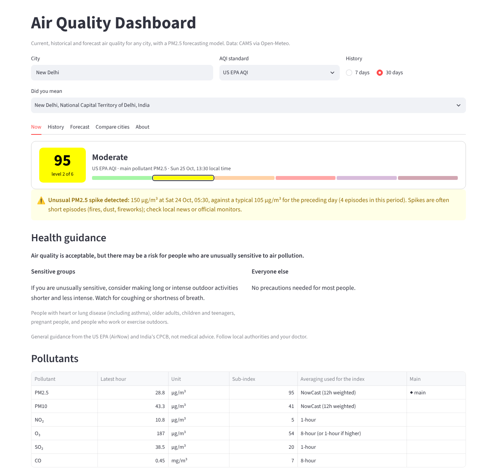
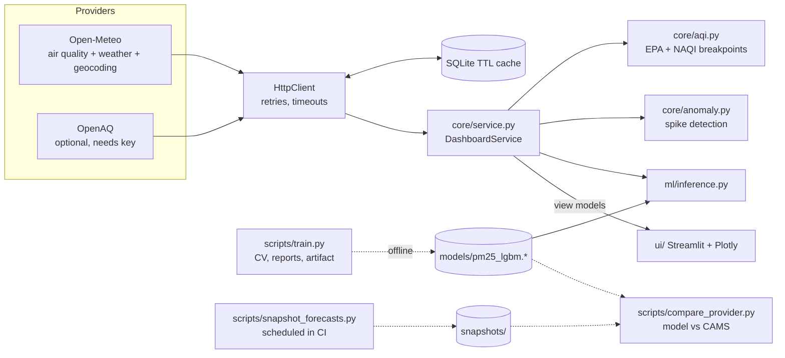
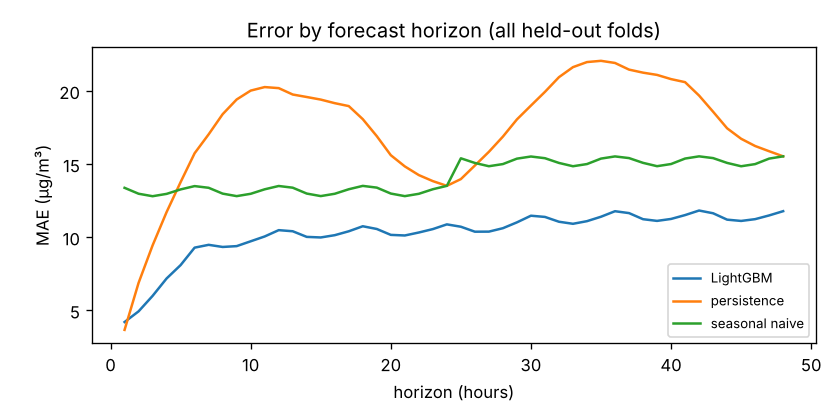
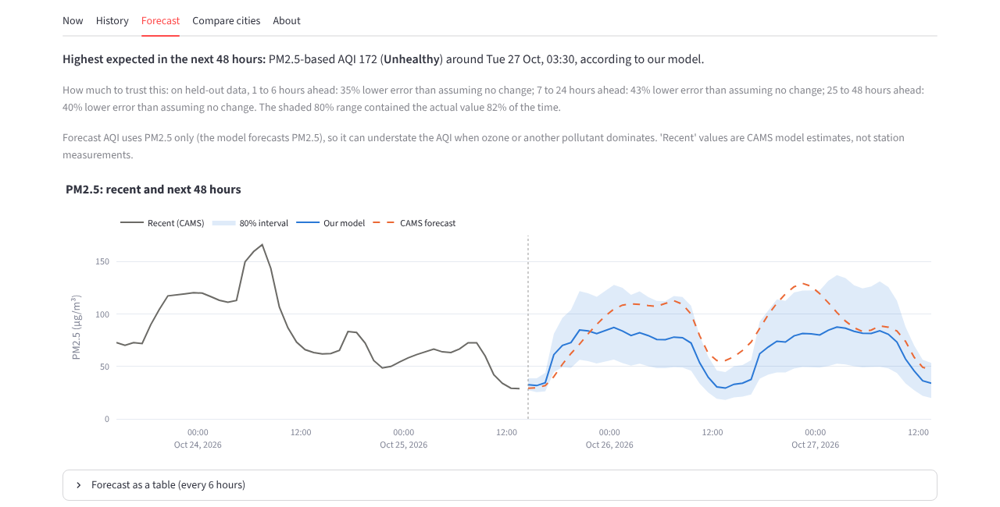

# Air Quality Dashboard

Current, historical and forecast air quality for any city, with a PM2.5 forecasting model at
its core. Built with Streamlit, Plotly, pandas and LightGBM on free data from
[Open-Meteo](https://open-meteo.com/) (CAMS air quality).



_Live data for New Delhi, captured 25 Oct 2026._

## Features

- **Current AQI** for any city, in **US EPA** or **India NAQI**, with a colour-coded category
  that is also written out in text and shown as "level N of 6", so it never relies on colour alone.
- **Pollutant breakdown**: PM2.5, PM10, NO₂, O₃, SO₂ and CO with units, sub-indices and the
  averaging period each standard uses (NowCast, 1-hour, 8-hour, 24-hour).
- **Health guidance** per category, worded after AirNow (EPA) and CPCB (NAQI).
- **History**: daily AQI bars and hourly AQI for the last 7 or 30 days, plus pollutant trends.
- **Spike detection**: unusual PM2.5 jumps in recent readings are flagged on the chart and
  called out on the main tab.
- **48-hour forecast** from our LightGBM model with an 80% interval, next to the provider's
  own (CAMS) forecast, plus a plain-language statement of how much the model beat a naive
  forecast on held-out data.
- **Compare up to 5 cities**: current AQI and the last 14 days side by side.
- Works at phone widths; every chart has a hover layer and a table alternative.

## Architecture



| Package | Responsibility |
|---|---|
| `providers/` | `Provider` protocol; Open-Meteo (required, no key) and OpenAQ (optional) parse API JSON into UTC pandas frames in µg/m³ |
| `storage/` | SQLite response cache with per-entry TTL and stale fallback |
| `core/` | AQI maths, categories, health advice, anomaly detection, and `DashboardService`, which builds every view model |
| `ml/` | Features, time-series CV, baselines, LightGBM/SARIMAX, evaluation, inference |
| `ui/` | Streamlit layout and Plotly figures only; no business logic |

**Why these choices**
- **Service layer.** The UI only renders dataclasses, so every rule (averaging, categories,
  "is the forecast trustworthy enough to show") is unit-tested without Streamlit.
- **SQLite cache.** It is in the standard library and survives restarts, unlike Streamlit's
  in-memory cache. Expired entries are kept, so a provider outage shows the last good data
  with a banner instead of an error.
- **No pickle.** The model ships as LightGBM's text format plus JSON, so loading it can't run
  code and changes diff readably.
- **Training is separate from the app.** The app loads a committed artifact and never trains.

## Setup

Requires Python 3.11+.

```bash
git clone <your-repo-url> air-quality-dashboard && cd air-quality-dashboard
python -m venv .venv && source .venv/bin/activate      # Windows: .venv\Scripts\activate
pip install -e .                                       # app only
streamlit run app.py                                   # opens http://localhost:8501
```

For development (tests, linting, training): `pip install -e ".[dev]" && pre-commit install`.

With Docker:

```bash
docker build -t air-quality-dashboard .
docker run --rm -p 8501:8501 air-quality-dashboard
```

## Configuration

All settings are optional environment variables (or a `.env` file; see `.env.example`).

| Variable | Default | Meaning |
|---|---|---|
| `AQD_DEFAULT_CITY` | `New Delhi` | City shown on load |
| `AQD_AQI_STANDARD` | `us_epa` | `us_epa` or `in_naqi` |
| `AQD_CACHE_PATH` | `.cache/aqd.sqlite3` | SQLite cache location |
| `AQD_CACHE_TTL_FORECAST` / `_HISTORY` / `_GEOCODE` | `3600` / `21600` / `2592000` | Cache lifetimes in seconds |
| `AQD_HTTP_TIMEOUT` | `10` | Provider timeout in seconds |
| `AQD_LOG_LEVEL` / `AQD_LOG_FORMAT` | `INFO` / `json` | Structured JSON logs to stdout (`text` for local reading) |
| `AQD_MODEL_DIR` | `models` | Where the model artifact lives |
| `OPENAQ_API_KEY` | unset | Enables the optional OpenAQ ground-station reading |

No secrets live in the code or git history; `.env` is gitignored and pre-commit runs
`detect-private-key`.

## Testing and quality

```bash
pytest                      # all tests, no network access needed (recorded fixtures + fakes)
pytest --cov                # coverage; fails under 80%
ruff check . && ruff format --check .
mypy                        # strict
```

Tests cover AQI breakpoint edges and worked reference values for both standards, NowCast and
averaging rules, provider parsing against recorded responses, caching and retries, feature
engineering (including a test that rewrites every value after the forecast origin and checks
that no feature changes), CV fold isolation, the models, the service layer, an end-to-end
pipeline with a mocked provider, and the Streamlit page itself via `streamlit.testing`.
CI runs lint, types and tests on Python 3.11 and 3.12.

## Deployment

- **Streamlit Community Cloud** (free): push to GitHub, create an app pointing at `app.py`.
  It installs from `requirements.txt` (pinned versions from `requirements.lock`, then the
  package itself). Add `OPENAQ_API_KEY` under the app's secrets if you want station data.
- **Any container host** (Render, Fly.io, Cloud Run): use the `Dockerfile`. It runs as a
  non-root user, has a health check on `/_stcore/health`, and keeps its cache in `/tmp`.

Open-Meteo's free tier is for non-commercial use (under 10,000 calls a day). The cache keeps a
normal session to a few calls per city per hour.

## The forecasting model

The app forecasts **hourly PM2.5 for the next 48 hours** and derives a PM2.5-based AQI from it.
See [MODEL_CARD.md](MODEL_CARD.md) for the full details. In short:

- **Data**: hourly CAMS PM2.5, PM10, NO₂, O₃, SO₂ and CO plus weather for 10 cities with very
  different regimes (Delhi, Mumbai, Lahore, Beijing, Cairo, Lagos, London, Los Angeles,
  São Paulo, Jakarta), from August 2022. Training weather comes from Open-Meteo's
  *historical forecast* archive. That archive stitches the first hours of each run together,
  so the weather at the target hour is a short-range forecast, sharper than the 1-2 day
  forecast the app actually has. A no-weather ablation below bounds how much that helps.
- **Models**: persistence and seasonal-naive baselines, SARIMAX (Fourier daily terms), and a
  single global LightGBM direct multi-horizon model (horizon as a feature, log-ratio target).
- **Evaluation**: rolling-origin CV with 6 folds of 30 days and a 48-hour gap, so no training
  target falls inside a test window. Metrics: MAE, RMSE and skill versus persistence by
  horizon bucket. 80% intervals come from out-of-fold residuals (split conformal), and the
  achieved coverage is reported.

### Results

Held-out period 26 Apr to 23 Oct 2026 (6 folds of 30 days), 10 cities, 343,840 forecasts.
MAE in µg/m³ against CAMS. Skill is the reduction in MAE versus persistence ("no change").
From [`reports/results.md`](reports/results.md) and
[`reports/metrics.json`](reports/metrics.json).

| Model | MAE 1-6h | MAE 7-24h | MAE 25-48h | RMSE (all) | Skill vs persistence (all) |
|---|---|---|---|---|---|
| Persistence | 10.20 | 17.73 | 18.85 | 29.40 | 0% |
| Seasonal naive (same hour yesterday) | 13.14 | 13.15 | 15.20 | 23.89 | 18% |
| **LightGBM** | **6.61** | **10.15** | **11.21** | **17.78** | **41%** |

SARIMAX needs one fit per origin, so it ran at one origin per city per day. On those same
86,140 rows:

| Model | MAE 1-6h | MAE 7-24h | MAE 25-48h | Skill vs persistence (all) |
|---|---|---|---|---|
| Persistence | 12.67 | 17.14 | 19.08 | 0% |
| Seasonal naive | 12.20 | 13.46 | 15.20 | 19% |
| SARIMAX | 7.28 | 12.30 | 13.02 | 31% |
| **LightGBM** | **5.86** | **10.50** | **11.17** | **42%** |



How to read this honestly:

- **Persistence wins at 1 hour ahead** (MAE 3.66 vs 4.20). LightGBM is better from 2 hours on.
- **Skill varies by city**: from 21% (Mumbai) and 26% (Delhi) to 57% (Jakarta).
- **Long-horizon skill is somewhat flattered.** Training and CV use archived weather that is
  sharper than a real 1-2 day forecast. With every weather input removed, skill falls from 41%
  to 33% overall and from 40% to 32% at 25-48 h. Real-world skill should sit between the two.
- **The test window is summer and monsoon.** It misses the Nov-Feb smog season in North India,
  Pakistan and Beijing, when errors in absolute terms will be much larger.
- **80% intervals covered 82%** of held-out values overall. They are fixed per horizon, so
  expect under-coverage during pollution episodes.



**Against the provider's own forecast.** Open-Meteo doesn't archive past air-quality
forecasts, so a scheduled workflow (`.github/workflows/snapshot.yml`) saves the CAMS forecast
twice a day into `snapshots/`. Once a few days of snapshots have their actuals,
`python scripts/compare_provider.py` scores CAMS and our saved model on every snapshot issued
after the training data ends and writes `reports/provider_comparison.md`. There is no result
yet: the first snapshot was taken on 25 Oct 2026. Expect CAMS to win at short horizons, partly
by construction, because the "actuals" are stitched from CAMS's own runs. A first live run
showed CAMS with zero error 1-2 hours after issue for exactly that reason, so only the 25-48 h
bucket is a reasonably fair comparison.

> **Heads-up:** once this repo is on GitHub, the snapshot workflow commits a small file to
> `main` twice a day. Disable it in the Actions tab if you don't want those commits.

## Limitations

- **"Observed" values are CAMS model estimates, not station measurements.** Every metric
  measures how well we forecast CAMS. Local station readings can differ a lot, especially in
  cities with strong local sources. Set `OPENAQ_API_KEY` to see the nearest station alongside.
- **The comparison with the provider favours CAMS.** Its forecasts are scored against its own
  stitched archive, so at short horizons the provider's forecast and the "actual" are the
  same numbers.
- **Long-horizon skill is optimistic.** Training weather comes from an archive of
  short-range forecasts, sharper than what the app has 1-2 days ahead (see the ablation above).
- **Evaluated on six months only** (late April to late October), which excludes the winter
  smog season where the model matters most for South Asian cities.
- **CAMS global is coarse.** It runs at about 45 km and every 3 hours (interpolated to hourly),
  so street-level and short spikes are smoothed out.
- **Forecast AQI is PM2.5-only.** It can understate the AQI when ozone or another pollutant
  dominates.
- **Rare events are poorly predicted.** Wildfires, dust storms and festival fireworks are
  rare in training data. The model will usually be late and too low on these.
- **Health guidance is general information, not medical advice.**

## What I'd improve next

- Train and evaluate against ground-station data (OpenAQ) where it exists, and learn a
  correction from CAMS to station values.
- Use the CAMS forecast itself as a feature (a stacking/post-processing model) once enough
  snapshots exist; it's likely the strongest single predictor.
- Quantile LightGBM or conformalized quantile regression for intervals that adapt to
  conditions instead of fixed per-horizon offsets.
- Forecast PM10 and O₃ too, so the forecast AQI covers more than PM2.5.
- Drift monitoring: track live error against the snapshots and alert when skill drops.

## Data and attribution

- Air quality: Copernicus Atmosphere Monitoring Service (CAMS) via
  [Open-Meteo.com](https://open-meteo.com/), CC BY 4.0.
- Weather and geocoding: [Open-Meteo.com](https://open-meteo.com/) (geocoding uses GeoNames),
  CC BY 4.0.
- Optional ground stations: [OpenAQ](https://openaq.org/) and its upstream data providers.
- AQI definitions: US EPA, 40 CFR Part 58 Appendix G (2024 revision); CPCB National Air
  Quality Index (2014).
